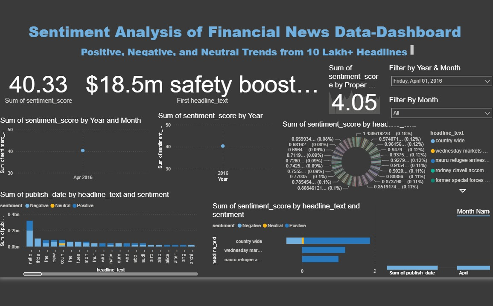

# Financial Market Sentiment Intelligence Dashboard

An interactive **Power BI dashboard for financial news sentiment analysis**, designed to explore sentiment patterns, track changes in market mood, and identify potential sentiment drivers across more than **1 million financial news headlines**.

The project transforms large-scale financial text data into interactive visual insights through time-series analysis, keyword frequency exploration, and sentiment-focused reporting.

## Dashboard Preview

## Project Overview

Financial news can provide valuable signals about market perception and investor sentiment. This project presents a visual analytics solution for exploring how sentiment evolves over time and which keywords appear frequently in financial news.

Built with Microsoft Power BI, the dashboard combines data modeling, sentiment analysis, and interactive visualizations to support the exploration of large volumes of financial headlines.

## Key Features

- **Large-Scale Data Analysis:** Designed to analyze a dataset containing 1M+ financial news headlines.
- **Sentiment Analysis:** Explore sentiment patterns across financial news data.
- **Time-Series Analysis:** Investigate changes in sentiment over time and observe market mood transitions.
- **Keyword Frequency Analysis:** Identify frequently occurring terms and potential sentiment drivers.
- **Interactive Visualizations:** Explore the data through interactive charts and dashboard visuals.
- **Drill-Down Exploration:** Investigate patterns at a more detailed level using available dashboard interactions.
- **Data Modeling and ETL:** Organize and prepare data for efficient analysis and reporting.

## Technology Stack

| Technology | Purpose |
|---|---|
| Microsoft Power BI | Dashboard development and data visualization |
| DAX | Measures and analytical calculations |
| Data Modeling | Organizing data for reporting |
| ETL Processes | Data preparation and transformation |
| Sentiment Analysis | Exploring sentiment in financial text |

## Key Achievements

- Processed and visualized financial text data at a scale of 1M+ headlines.
- Developed time-series visualizations to examine sentiment volatility and changes in market mood.
- Implemented keyword frequency analysis to investigate recurring terms and emerging trends.
- Designed an interactive dashboard with drill-down capabilities for deeper data exploration.

## Repository Contents

\`\`\`text
Financial-Sentiment-PowerBI/
├── Research Project Dashboard.pbix
├── README.md
└── screenshots/
    └── power-bi-dashboard-ui.jpeg
\`\`\`

## How to View the Dashboard

1. Open this repository on GitHub.
2. Download `Research Project Dashboard.pbix`.
3. Open the file using Microsoft Power BI Desktop.
4. Explore the available visuals, filters, and drill-down interactions.

**Note:** GitHub can store the `.pbix` file, but it does not render the interactive Power BI dashboard directly in the repository. Open it in Power BI Desktop to explore the report.

## Project Information

- **Project:** Financial Market Sentiment Intelligence Dashboard
- **Timeline:** September 2025
- **Domain:** Financial Analytics and Business Intelligence
- **Primary Tool:** Microsoft Power BI

## Author

**Ratnesh Pathak**

- [GitHub](https://github.com/RatneshPathak)
- [LinkedIn](https://www.linkedin.com/in/ratnesh-pathak-087466279/)

---

*Developed to explore financial news sentiment through data analytics and interactive business intelligence.*
